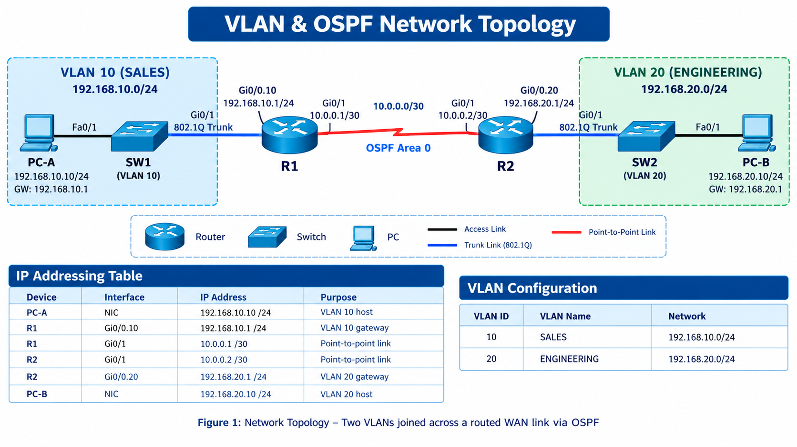

# VLAN & OSPF Dynamic Routing Lab

A Cisco networking lab demonstrating VLAN segmentation, Router-on-a-Stick inter-VLAN routing, point-to-point connectivity, and dynamic routing using OSPF Area 0 in Cisco Packet Tracer.

## 📌 Project Overview

This project implements a multi-router network where two separate VLANs communicate across a routed point-to-point link. Cisco IOS configurations are used to establish VLAN connectivity, configure router sub-interfaces, and exchange network routes dynamically using OSPF.

The lab focuses on practical networking skills relevant to **Junior Network Engineer, NOC Engineer, and ISP Network Support** roles.

## 🖼️ Network Topology



*Figure 1: Network topology showing VLANs, routers, switches, and the point-to-point link.*


## 🎯 Project Objectives

- Create and configure VLAN 10 and VLAN 20.
- Configure switch access ports and 802.1Q trunking.
- Implement Router-on-a-Stick using router sub-interfaces.
- Configure IPv4 addressing and default gateways.
- Establish a routed point-to-point link between two Cisco routers.
- Configure OSPF dynamic routing in Area 0.
- Verify OSPF neighbor adjacency and routing-table entries.
- Troubleshoot connectivity and document the network configuration.

## 🛠️ Technologies & Tools

- Cisco IOS
- Cisco Packet Tracer
- VLANs (802.1Q)
- Router-on-a-Stick
- OSPF (Area 0)
- IPv4 addressing and subnetting
- Routing and Switching
- Network troubleshooting

## 🌐 Network IP Addressing

| Device | Interface | IP Address | Purpose |
|---|---|---|---|
| PC-A | NIC | `192.168.10.10/24` | VLAN 10 host |
| R1 | `Gi0/0.10` | `192.168.10.1/24` | VLAN 10 gateway |
| R1 | `Gi0/1` | `10.0.0.1/30` | Point-to-point link |
| R2 | `Gi0/1` | `10.0.0.2/30` | Point-to-point link |
| R2 | `Gi0/0.20` | `192.168.20.1/24` | VLAN 20 gateway |
| PC-B | NIC | `192.168.20.10/24` | VLAN 20 host |

### VLAN Configuration

| VLAN ID | VLAN Name | Network |
|---|---|---|
| 10 | SALES | `192.168.10.0/24` |
| 20 | ENGINEERING | `192.168.20.0/24` |

## ⚙️ Key Configuration Highlights

### 1. VLANs and Trunking

Created VLANs on the switches, assigned end-device ports to the appropriate access VLAN, and configured the router uplinks as 802.1Q trunks.

```cisco
vlan 10
 name SALES
!
interface range fastEthernet 0/1 - 10
 switchport mode access
 switchport access vlan 10
!
interface gigabitEthernet 0/1
 switchport mode trunk
 switchport trunk allowed vlan 10
```

For VLAN 20, the corresponding switch uses VLAN ID `20`, VLAN name `ENGINEERING`, and permits VLAN 20 on its trunk.

### 2. Router-on-a-Stick

Configured router sub-interfaces to provide default gateways for the VLANs.

**R1 — VLAN 10**

```cisco
interface gigabitEthernet 0/0
 no shutdown
!
interface gigabitEthernet 0/0.10
 encapsulation dot1Q 10
 ip address 192.168.10.1 255.255.255.0
```

**R2 — VLAN 20**

```cisco
interface gigabitEthernet 0/0
 no shutdown
!
interface gigabitEthernet 0/0.20
 encapsulation dot1Q 20
 ip address 192.168.20.1 255.255.255.0
```

### 3. Point-to-Point Routing Link

Configured a `/30` network between the routers.

**R1**

```cisco
interface gigabitEthernet 0/1
 ip address 10.0.0.1 255.255.255.252
 no shutdown
```

**R2**

```cisco
interface gigabitEthernet 0/1
 ip address 10.0.0.2 255.255.255.252
 no shutdown
```

### 4. OSPF Dynamic Routing

Configured OSPF process 1 in Area 0 to advertise the local VLAN subnet and the point-to-point network.

**R1**

```cisco
router ospf 1
 router-id 1.1.1.1
 network 192.168.10.0 0.0.0.255 area 0
 network 10.0.0.0 0.0.0.3 area 0
```

**R2**

```cisco
router ospf 1
 router-id 2.2.2.2
 network 192.168.20.0 0.0.0.255 area 0
 network 10.0.0.0 0.0.0.3 area 0
```

## 🧪 Verification & Testing

The following commands are used to inspect the configuration and verify routing.

| Command | Purpose |
|---|---|
| `show ip interface brief` | Check interface status and IP addresses |
| `show vlan brief` | Verify VLAN creation and port assignments |
| `show interfaces trunk` | Verify trunk status and allowed VLANs |
| `show ip ospf neighbor` | Check OSPF neighbor adjacency |
| `show ip route ospf` | Inspect dynamically learned OSPF routes |
| `show ip protocols` | Verify OSPF process and advertised networks |

### Connectivity Tests

From PC-A:

```text
ping 192.168.20.10
```

From PC-B:

```text
ping 192.168.10.10
```

Expected results:

- OSPF neighbor adjacency reaches the `FULL` state.
- Each router learns the remote VLAN subnet through OSPF.
- Both PCs can reach their local default gateways.
- End-to-end pings succeed between PC-A and PC-B.

## 🔧 Troubleshooting

Issues investigated in this lab include:

- Incorrect VLAN assignments or trunk configuration.
- Mismatched VLAN IDs on router sub-interfaces.
- Incorrect IP addresses, subnet masks, or default gateways.
- Interfaces that are administratively down.
- OSPF network statements or wildcard-mask mismatches.
- Missing OSPF routes or neighbor adjacency problems.

## 📂 Project Files

| File | Description |
|---|---|
| `jisanviproject.pkt` | Cisco Packet Tracer project file |
| `VLAN-OSPF-Dynamic-Routing.pdf` | Lab documentation |
| `images/topology.png` | Network topology screenshot |
| `images/ospf-neighbor.png` | OSPF verification screenshot |
| `images/connectivity-test.png` | End-to-end connectivity screenshot |

*Ensure the files and screenshots are uploaded to the repository using the corresponding names.*

## 🚀 How to Use

1. Clone or download this repository.
2. Install Cisco Packet Tracer.
3. Open `jisanviproject.pkt` in Packet Tracer.
4. Inspect the topology, device configurations, VLANs, and OSPF setup.
5. Run the verification commands and connectivity tests.

## 📚 Key Learning Outcomes

- Practical understanding of Layer 2 VLAN segmentation.
- Experience configuring 802.1Q trunking and router sub-interfaces.
- Understanding IPv4 point-to-point addressing.
- Hands-on experience with OSPF neighbor formation and dynamic route advertisement.
- Improved network verification and troubleshooting skills.

## 👨‍💻 Author

**Md. Indadul Matubbar**

Diploma in Computer Science and Technology  
Networking | Routing & Switching | Cybersecurity

- **GitHub:** [0diNx1](https://github.com/0diNx1)
- **Medium:** [0xodinx](https://0xodinx.medium.com)

---

If you find this project useful for learning networking, feel free to explore the configurations and use the lab for educational purposes.

*Built as a hands-on Cisco networking project to strengthen practical routing and switching skills.*
